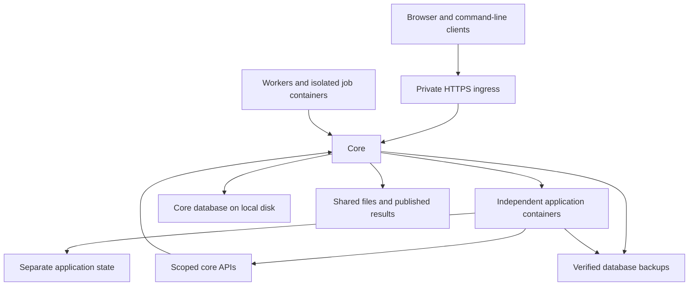

# Architecture

Home Platform is a coordinator and organizer for independent applications and
shared compute. One core provides a browser entry point, identity, files, and a
durable job queue. Applications own their domain behavior in separate
repositories. Workers supply execution capacity when available.

The design keeps coordination separate from execution. A worker can sleep or
lose its connection while the core preserves job truth. An application can
change its dependencies and release schedule without becoming part of the
core's source tree.

## Components and ownership

Arrows show request or data dependencies. Workers initiate their connections to
the core. The diagram describes responsibilities rather than a machine
inventory.

| Component | Owns | Detail |
|---|---|---|
| Core interfaces | Launcher, accounts, Job Desk, Files, and administrator controls | [Access control](access-control.md) |
| Compute | Queue, leases, placement, worker software, and result publication | [Compute](compute/README.md) |
| Application integration | Registration, gateway, scoped APIs, discovery, previews, and approved installation | [Applications](apps/README.md) |
| Storage | Logical file areas, owner checks, and controlled publication | [Storage](storage/README.md) |
| Network boundary | Private reachability and trusted ingress | [Network](network.md) |
| Runtime configuration | Core and worker settings and limits | [Configuration](configuration.md) |

Job Desk, Files, the scheduler, and worker software remain core functions.
Independent applications use their supported HTTP interfaces. Applications do
not import core implementation modules or open the core database.

An application owns its repository, dependencies, tests, image, business logic,
and private state. Pages that share that state and lifecycle remain one
application. A page does not need its own container merely because it has a
different URL.

## Requests and identity

Clients reach a private HTTPS ingress. The core serves its own routes and sends
registered application paths through the gateway. Adding a managed application
changes the registry rather than adding a public backend port.

Private network membership supplies reachability. The core resolves a trusted
external identity to a linked account, and enforces roles and immutable user
ownership. Administrative actions also require an administrator session.
Knowing a resource identifier never grants access to it.

The gateway supplies a short-lived context bound to an application and an
environment. The application verifies that context through the core API using
its own credential, then enforces ownership of its own data. Raw forwarded
identity headers are not an application authentication contract.

Loopback publishing prevents remote clients from bypassing ingress. Local
processes can still reach loopback, so the host and ingress remain trusted.
Same-origin applications are also trusted browser code. Separate containers
and credentials do not isolate malicious JavaScript sharing the core's origin.
See [Network](network.md) and the [runtime contract](apps/runtime-contract.md).

## Independent application releases

The operator registers an application and its allowed capabilities. An app
release publishes a manifest and an immutable container image. Discovery
records the exact assets and provenance rather than following a mutable tag
at deployment time.

Preview and compatibility checks precede approval. Approval identifies an exact
release and the state against which it was checked. A bounded host helper
performs privileged installation using operator-owned policy. The web process
cannot edit that policy or run arbitrary host commands.

Each installed app has a distinct account, credentials, state directory,
resource limits, and lifecycle. Optional platform capabilities grant narrow
access to compute or files rather than general access to the core database.
Host integrations and secrets require explicit operator policy.

See the [release contract](apps/release-contract.md),
[registry](apps/registry.md), and [installation model](apps/installation.md).

## Leased compute

Clients submit jobs to the core. Eligible workers poll for work, claim it
atomically, and renew a lease while executing. A worker that loses its lease
cannot publish results over a replacement's work. Expired leases return work
to the queue within a bounded attempt limit.

Workers register with scheduling disabled. Placement uses declared capacity
envelopes and supported job types. Job code runs in a bounded container with
restricted filesystem access and no network, rather than inside the worker
agent. Container isolation limits the job's access but is not a substitute for
trust in the host kernel and container runtime.

Small inputs can pass through the core. Large linked inputs travel directly to
the selected worker and are verified by size and digest. Reusable input caches
are bounded. Result publication requires the current lease, and the core
chooses the final owner-scoped location.

The [compute overview](compute/README.md) explains recovery and placement.
Outside job authors can use the [Python guide](compute/python-script.md),
[batch project guide](compute/batch-script.md), and
[job contract](compute/job-contract.md) without knowing deployment paths.

## State and files

The core database stores accounts, registrations, jobs, leases, and related
coordination state. Each application owns a separate database. Live SQLite
databases stay on local disk because network filesystems may not provide the
locking guarantees they require.

Members address files through logical `Home`, `Shared`, and `Artifacts` areas.
The core resolves paths against the authenticated account. Filesystem
permissions independently protect direct file-server access. Application
authorization does not replace those permissions.

The coordinator owns published job output. Workers cannot choose another
user's result directory, and file-share clients cannot create a second writer
for the result store. Workspace edits use a separate, narrowly authorized
storage identity.

Backups use a consistent database snapshot, verify it, and publish a digest.
A backup's integrity check proves the copy can be read. Recovery procedures
must also account for application state, credentials, and filesystem access.
See [Storage](storage/README.md) and the [file workflow](storage/workflow.md).

## Failure and capacity

This is a single-coordinator design with one database writer. A core outage
interrupts submission, authentication, and application routing. Independent
application containers do not make the shared host highly available.

Worker loss is an expected failure. Leases recover abandoned work, and current
lease checks reject stale publication. External application providers and
shared file storage can fail independently of the queue.

Placement uses fixed capacity rather than live load, thermal state, or input
locality. Artifact publication still passes through the core. Those choices
keep coordination small and predictable but bound throughput. Larger fleets
or stronger availability requirements would need a different coordination and
publication design.
